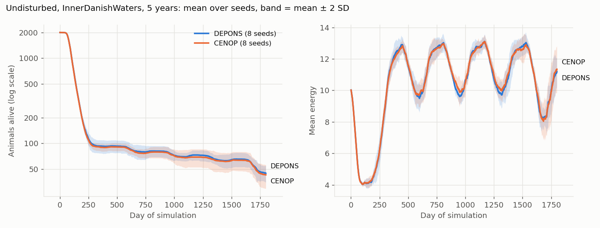
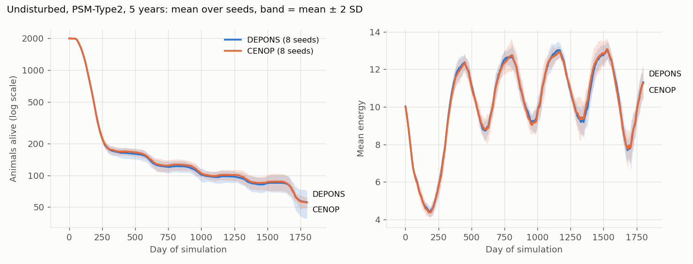
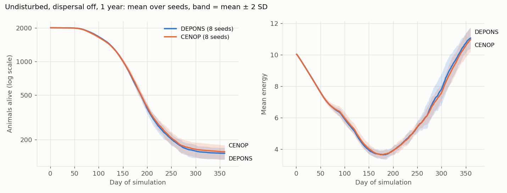
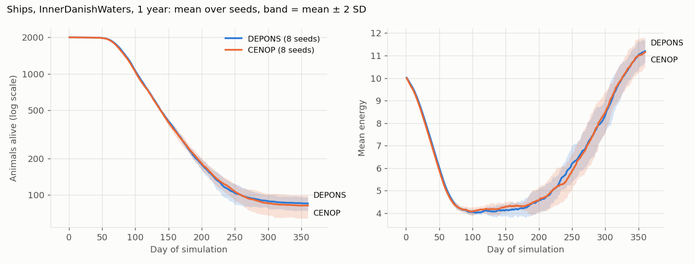

# A2 parity tables (generated)

Generated by `python3 -m validation.a2.report`; do not edit by hand.

## Verdicts

| Metric | Undisturbed, InnerDanishWaters, 5 years | Undisturbed, PSM-Type2, 5 years | Undisturbed, dispersal off, 1 year | Ships, InnerDanishWaters, 1 year |
|---|---|---|---|---|
| M1 population | INCONCLUSIVE | INCONCLUSIVE | PASS | FAIL |
| M2 trajectory | PASS | PASS | PASS | FAIL |
| M3 mean energy | INCONCLUSIVE | PASS | INCONCLUSIVE | FAIL |
| M4 location | PASS | PASS | n/a | PASS |
| M5 age at death | PASS | PASS | PASS | PASS |
| M6 ship effect | n/a | n/a | n/a | PASS |
| M7 exposure | n/a | n/a | n/a | FAIL |

## Undisturbed, InnerDanishWaters, 5 years

Java seeds: 8. CENOP seeds: 8.

**M1 Population** (mean over seeds)

| Checkpoint | Java | CENOP | Difference | In SE | Verdict |
|---|---|---|---|---|---|
| end of year 1 | 92.9 | 89.9 | -3.0 (-3.2%) | -0.9 | PASS |
| end of year 2 | 79.5 | 76.5 | -3.0 (-3.8%) | -1.0 | PASS |
| end of year 3 | 69.8 | 68.1 | -1.6 (-2.3%) | -0.5 | PASS |
| end of year 4 | 62.6 | 61.4 | -1.2 (-2.0%) | -0.4 | INCONCLUSIVE (2 SE exceeds the band: too noisy to resolve it) |
| end of year 5 | 44.6 | 42.8 | -1.9 (-4.2%) | -0.6 | INCONCLUSIVE (2 SE exceeds the band: too noisy to resolve it) |

**M2 Trajectory.** CENOP's mean is inside Java's mean +/- 2 SD on 99.9% of days (band: at least 95%). PASS.

**M3 Mean energy** (population-wide)

| Checkpoint | Java | CENOP | Difference | In SE | Verdict |
|---|---|---|---|---|---|
| day 30 | 8.02 | 8.01 | -0.02 | -0.8 | PASS |
| day 90 | 4.16 | 4.13 | -0.02 | -0.9 | PASS |
| day 150 | 4.12 | 4.12 | -0.00 | -0.0 | PASS |
| day 240 | 5.68 | 5.76 | +0.08 | +0.4 | INCONCLUSIVE (2 SE exceeds the band: too noisy to resolve it) |
| day 359 | 11.73 | 11.70 | -0.03 | -0.2 | INCONCLUSIVE (2 SE exceeds the band: too noisy to resolve it) |

**M4 Location.** Share of animals per 40 km block, days 30-360: total variation distance 0.016 (band: at most 0.06), correlation 0.999 (band: at least 0.98). PASS.

**M5 Age at death.** 15741 Java and 15735 CENOP deaths, mean age 3.78 and 3.81; Kolmogorov-Smirnov statistic 0.0083, p = 0.654 (band: p above 0.01). PASS.

## Undisturbed, PSM-Type2, 5 years

Java seeds: 8. CENOP seeds: 8.

**M1 Population** (mean over seeds)

| Checkpoint | Java | CENOP | Difference | In SE | Verdict |
|---|---|---|---|---|---|
| end of year 1 | 167.1 | 170.4 | +3.2 (+1.9%) | +0.8 | PASS |
| end of year 2 | 121.6 | 124.1 | +2.5 (+2.1%) | +0.6 | PASS |
| end of year 3 | 97.0 | 99.0 | +2.0 (+2.1%) | +0.8 | PASS |
| end of year 4 | 82.0 | 84.9 | +2.9 (+3.5%) | +0.9 | PASS |
| end of year 5 | 55.5 | 55.4 | -0.1 (-0.2%) | -0.0 | INCONCLUSIVE (2 SE exceeds the band: too noisy to resolve it) |

**M2 Trajectory.** CENOP's mean is inside Java's mean +/- 2 SD on 100.0% of days (band: at least 95%). PASS.

**M3 Mean energy** (population-wide)

| Checkpoint | Java | CENOP | Difference | In SE | Verdict |
|---|---|---|---|---|---|
| day 30 | 8.48 | 8.50 | +0.02 | +0.6 | PASS |
| day 90 | 5.99 | 5.94 | -0.05 | -0.7 | PASS |
| day 150 | 4.70 | 4.61 | -0.09 | -1.4 | PASS |
| day 240 | 5.39 | 5.44 | +0.05 | +0.4 | PASS |
| day 359 | 11.02 | 10.89 | -0.13 | -1.1 | PASS |

**M4 Location.** Share of animals per 40 km block, days 30-360: total variation distance 0.016 (band: at most 0.06), correlation 0.999 (band: at least 0.98). PASS.

**M5 Age at death.** 15653 Java and 15672 CENOP deaths, mean age 3.86 and 3.90; Kolmogorov-Smirnov statistic 0.0105, p = 0.35 (band: p above 0.01). PASS.

## Undisturbed, dispersal off, 1 year

Java seeds: 8. CENOP seeds: 8.

**M1 Population** (mean over seeds)

| Checkpoint | Java | CENOP | Difference | In SE | Verdict |
|---|---|---|---|---|---|
| day 90 | 1762.1 | 1745.5 | -16.6 (-0.9%) | -1.6 | PASS |
| day 180 | 574.0 | 580.4 | +6.4 (+1.1%) | +0.5 | PASS |
| day 270 | 175.5 | 178.5 | +3.0 (+1.7%) | +0.5 | PASS |
| day 359 | 151.4 | 156.2 | +4.9 (+3.2%) | +1.0 | PASS |

**M2 Trajectory.** CENOP's mean is inside Java's mean +/- 2 SD on 99.7% of days (band: at least 95%). PASS.

**M3 Mean energy** (population-wide)

| Checkpoint | Java | CENOP | Difference | In SE | Verdict |
|---|---|---|---|---|---|
| day 30 | 8.63 | 8.62 | -0.01 | -0.4 | PASS |
| day 90 | 6.32 | 6.38 | +0.06 | +0.8 | PASS |
| day 150 | 3.93 | 4.02 | +0.09 | +1.3 | PASS |
| day 240 | 4.98 | 5.01 | +0.03 | +0.4 | PASS |
| day 359 | 11.03 | 10.92 | -0.12 | -0.6 | INCONCLUSIVE (2 SE exceeds the band: too noisy to resolve it) |

**M5 Age at death.** 14790 Java and 14750 CENOP deaths, mean age 3.74 and 3.80; Kolmogorov-Smirnov statistic 0.0111, p = 0.316 (band: p above 0.01). PASS.

## Ships, InnerDanishWaters, 1 year

Java seeds: 8. CENOP seeds: 8.

**M1 Population** (mean over seeds)

| Checkpoint | Java | CENOP | Difference | In SE | Verdict |
|---|---|---|---|---|---|
| day 90 | 1314.9 | 1285.9 | -29.0 (-2.2%) | -3.4 | FAIL |
| day 180 | 240.4 | 244.4 | +4.0 (+1.7%) | +0.9 | PASS |
| day 270 | 95.4 | 93.5 | -1.9 (-2.0%) | -0.5 | PASS |
| day 359 | 85.2 | 81.9 | -3.4 (-4.0%) | -0.9 | PASS |

**M2 Trajectory.** CENOP's mean is inside Java's mean +/- 2 SD on 94.7% of days (band: at least 95%). FAIL.

**M3 Mean energy** (population-wide)

| Checkpoint | Java | CENOP | Difference | In SE | Verdict |
|---|---|---|---|---|---|
| day 30 | 7.98 | 7.86 | -0.11 | -5.1 | FAIL |
| day 90 | 4.14 | 4.16 | +0.02 | +0.6 | PASS |
| day 150 | 4.14 | 4.29 | +0.16 | +2.5 | FAIL |
| day 240 | 5.71 | 5.37 | -0.33 | -2.0 | FAIL |
| day 359 | 11.18 | 11.13 | -0.05 | -0.3 | INCONCLUSIVE (2 SE exceeds the band: too noisy to resolve it) |

**M4 Location.** Share of animals per 40 km block, days 30-360: total variation distance 0.015 (band: at most 0.06), correlation 0.999 (band: at least 0.98). PASS.

**M5 Age at death.** 15317 Java and 15345 CENOP deaths, mean age 3.71 and 3.75; Kolmogorov-Smirnov statistic 0.0086, p = 0.618 (band: p above 0.01). PASS.

**M6 Ship effect on population**

| Checkpoint | Java | CENOP | Difference | In SE | Verdict |
|---|---|---|---|---|---|
| N with ships / N undisturbed, day 359 | 0.918 | 0.911 | -0.007 | -0.1 | PASS |

**M7 Exposure to ship noise** (Java: its 200 tracked animals per seed while alive; CENOP: all animals)

| Checkpoint | Java | CENOP | Difference | In SE | Verdict |
|---|---|---|---|---|---|
| share of animal-ticks with ship deterrence | 0.1920 | 0.2831 | +0.0911 | +72.0 | FAIL |

Band: within 20% of Java.

